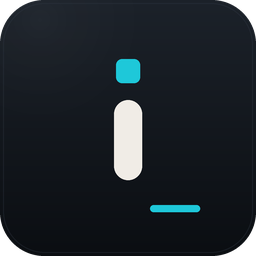

<p align="center">
  <a href="https://icreativate.co.za/">
    
  </a>
</p>

<p align="center">
  
</p>

<h1 align="center">iCreate</h1>

<p align="center">
  <b>One place to install, update and open every app in the Craft App Suite, rebuilt in pure Rust.</b><br>
  PhotoCraft, LightCraft, FilmCraft, DesignCraft, VectorCraft, PdfCraft, EffectCraft, WordCraft,<br>
  DeckCraft, GridCraft, CADCraft, SoundCraft, FigCraft, Craft Anything, TextureCraft, MaterialCraft and the community app SolidCraft: the right build for your computer, kept up to date.
</p>

<p align="center">
  
  
  
  
  <br>
  <a href="https://sonarcloud.io/project/overview?id=storytold_craft-launcher"></a>
  <a href="https://coderabbit.ai"></a>
</p>

<p align="center">
  <a href="https://github.com/iCreativate/icreate-launcher/releases/latest"><b>Download iCreate</b></a> ·
  <a href="https://icreativate.co.za/">iCreativate</a> ·
  <a href="https://getartcraft.com/apps">The Craft App Suite</a>
</p>

> [!NOTE]
> **iCreate** is a free creative suite from iCreativate, based on the open-source
> [ArtCraft Launcher](https://github.com/storytold/craft-launcher). It installs and updates the
> Craft App Suite. ArtCraft's name and marks stay with the ArtCraft team.

<p align="center">
  <a href="#what-it-does">What it does</a> ·
  <a href="#features">Features</a> ·
  <a href="#downloads">Downloads</a> ·
  <a href="#build-from-source">Build from source</a> ·
  <a href="#the-craft-app-suite">Craft App Suite</a> ·
  <a href="https://icreativate.co.za/">Website</a>
</p>

<p align="center">
  
</p>
<p align="center">
  <br>
  <sub>Switch between the grid and a sortable table.</sub>
</p>

## What it does

The Craft apps each ship their own builds for every platform. iCreate saves you from
hunting through a dozen release pages: it lists every app in the suite, shows which ones you have
and which version, installs the right build for your operating system and processor, and tells
you when an update is out. It is a small native app that can sit in your menu bar or system tray.

## Features

<table>
  <tr>
    <td width="33%" valign="top">
      <h3>📦 Install in one click</h3>
      Picks the right download for your OS and CPU (DMG, MSI, AppImage, .deb, .rpm and more), checks it against the release's SHA-256 checksums and installs it.
    </td>
    <td width="33%" valign="top">
      <h3>🔄 Stay up to date</h3>
      Checks each app's GitHub releases and updates the ones you have. A notification tells you when there's something new.
    </td>
    <td width="33%" valign="top">
      <h3>🧭 Always at hand</h3>
      Opens any Craft app from one window, or from the tray and menu-bar icon. Native egui, no Electron, no web view.
    </td>
  </tr>
</table>

The web version shows the same catalog in the browser, with the latest download for each app.

## Interface languages

The interface is in English, Brazilian Portuguese (Português (Brasil)), Czech (Čeština), French
(Français), Georgian (ქართული), German (Deutsch), Hungarian (Magyar), Japanese (日本語), Polish
(Polski), Russian (Русский), Simplified Chinese (简体中文), Traditional Chinese (繁體中文) or Spanish
(Español). **Auto**, the default, follows the system or browser language; **Settings → Language**
picks one and switches at once, and the choice is kept between runs. Czech locales (`cs-CZ`,
`cs_CZ.UTF-8`…) select Czech, Georgian ones (`ka`, `ka-GE`, `ka_GE.UTF-8`…) Georgian, German ones
(`de-DE`, `de-AT`, `de-CH`, `de_DE.UTF-8`…) German, French ones (`fr-FR`, `fr-CA`…) French, Hungarian
ones (`hu`, `hu-HU`, `hu_HU.UTF-8`…) Hungarian, Japanese ones (`ja`, `ja-JP`, `ja_JP.UTF-8`…)
Japanese, Polish ones (`pl`, `pl-PL`, `pl_PL.UTF-8`) Polish, Spanish ones (`es-ES`, `es-MX`,
`es-419`…) Spanish, and Portuguese ones (`pt-BR`, and `pt-PT` too, for now) Brazilian Portuguese.
Simplified Chinese locales (`zh-CN`, `zh-SG`, `zh-Hans`, and POSIX forms such as `zh_CN.UTF-8`)
select Simplified Chinese; Traditional Chinese ones (`zh-TW`, `zh-HK`, `zh-MO`, `zh-Hant`, and POSIX
forms such as `zh_TW.UTF-8`) select Traditional Chinese, with an explicit script winning over the
region. To try a language without changing the setting, start the desktop app with
`ARTCRAFT_LAUNCHER_LOCALE=pt-BR`, or add `?lang=ru` to the web address.

The CJK languages are drawn with the system's own CJK font (Hiragino Sans or PingFang on macOS,
Yu Gothic, Meiryo or Microsoft YaHei on Windows, Noto Sans CJK, IPA, Takao or WenQuanYi on Linux and
FreeBSD); Traditional Chinese prefers an installed Noto Sans CJK TC, then PingFang TC, Microsoft
JhengHei or MingLiU. Georgian is drawn the same way, with the system's Georgian font (SF Georgian or
Arial Unicode on macOS, Sylfaen on Windows, Noto Sans Georgian or DejaVu Sans on Linux and FreeBSD).
Where the system has no font for one, and in the web version, the interface stays in English and
Settings says why. Product names and release notes stay as published; text without a translation
falls back to English. See [`docs/localization-zh-hant.md`](docs/localization-zh-hant.md) for the
Traditional Chinese catalog and font details.

## Where apps are installed

iCreate installs each app where your system normally keeps applications, using the
app's official release package, so an app installed by the launcher is the same as one you
installed by hand (and the launcher finds apps you installed yourself):

| System | Where | How |
|---|---|---|
| macOS | `/Applications/<App>.app` | Copied from the signed, notarized release DMG |
| Windows | `C:\Program Files\ArtCraft\<App>` (`Program Files (x86)` for a 32-bit build) | The release MSI, through Windows Installer, for everyone on the computer (with Start menu entry and Apps & features entry). Windows asks for administrator permission for each new install. An app already installed for your account only (`%LOCALAPPDATA%\Programs\ArtCraft\<App>`) keeps its folder and scope when updated; to move it, uninstall it and install it again |
| Linux | `/usr/bin`, `/usr/share/applications` | The release `.deb` (apt) or `.rpm` (dnf, zypper), with your system's password prompt. Without those, a Flatpak, or an AppImage in `~/Applications` |
| Linux, inside the launcher's Flatpak, with no Flatpak on the host | `~/.var/app/za.co.icreativate.icreate/data/icreate/apps/<app>` | The release tarball, unpacked into the launcher's own folder and run inside the same sandbox, with its settings in a `home/` folder beside it. Nothing is installed on the host, and each app's configuration stays in the sandbox |
| FreeBSD | `/usr/local` | The release tree, with a password prompt (polkit); `~/.local` when polkit isn't installed |

iCreate keeps itself current too: when a new version is out, **Update and restart**
downloads it, verifies it, puts it where this copy is installed (the `.app`, the Windows Installer
package or portable folder, the AppImage, or the `.deb`/`.rpm`) and reopens it.

Updates use the same format an app was installed with. Every download is checked against the
release's published SHA-256 before it is installed, and a running app is never replaced.

The launcher writes its log to `logs/artcraft-launcher.log` in its data folder
(`~/.local/share/icreate` on Linux, `~/Library/Application Support/iCreate`
on macOS, `%LOCALAPPDATA%\iCreate` on Windows, `iCreateData` beside the
portable zip's executable) and keeps the previous two runs as `artcraft-launcher.1.log` and
`artcraft-launcher.2.log`. `RUST_LOG` changes what it records (`debug`, `info,zbus=warn`, …).

## Downloads

Download the build for your computer from the [latest release](https://github.com/iCreativate/icreate-launcher/releases/latest), or browse [all releases](https://github.com/iCreativate/icreate-launcher/releases). Every release has a `SHA256SUMS.txt` to check the files against. `<ver>` is the version number, for example `1.0.0`. Tag `v<ver>` to build it ([docs/releasing.md](docs/releasing.md)).

Until Apple and Windows signing certificates are configured, the installers are **unsigned**. Gatekeeper and SmartScreen will warn. That is expected — see [Opening unsigned builds](#opening-unsigned-builds).

**Windows** (10 and 11)

| File | What it is |
|---|---|
| `artcraft-launcher-<ver>-windows-x64.msi` | Installer for most PCs (Intel and AMD, 64-bit). Installs for the current user, no admin rights needed |
| `artcraft-launcher-<ver>-windows-x64-portable.zip` | No install: unzip and run `artcraft-launcher.exe`. Keeps its settings in the folder |

**macOS** (11 Big Sur or later)

| File | What it is |
|---|---|
| `artcraft-launcher-<ver>-macos-universal.dmg` | Universal app for Apple silicon **and** Intel Macs. Drag iCreate to Applications |

**Linux** (x86_64 and aarch64; glibc 2.35 or newer, e.g. Ubuntu 22.04+, Debian 12+)

| File | What it is |
|---|---|
| `artcraft-launcher-<ver>-linux-{x86_64,aarch64}.AppImage` | Runs on almost any distro without installing; `chmod +x` and run. The `.AppImage.zsync` beside it lets AppImageUpdate fetch only what changed |
| `artcraft-launcher-<ver>-linux-{x86_64,aarch64}.deb` | Debian, Ubuntu, Mint, Pop!_OS: `sudo apt install ./artcraft-launcher-…deb` |

The tray icon uses the StatusNotifierItem standard: KDE, Xfce, Cinnamon and most other desktops show it; on GNOME install the AppIndicator extension.

### Opening unsigned builds

**macOS.** Open the `.dmg`, drag iCreate to Applications, then in Finder Control-click iCreate → **Open** → **Open**. Or: `xattr -cr /Applications/iCreate.app && open /Applications/iCreate.app`.

**Windows.** Run the `.msi`. If SmartScreen says Windows protected your PC, choose **More info** → **Run anyway** only if you downloaded it from the GitHub release above.

**Linux.** `chmod +x` the AppImage and run it, or `sudo apt install ./artcraft-launcher-….deb`.

**Web (WebAssembly)**

| File | What it is |
|---|---|
| `artcraft-launcher-web-<ver>.zip` | The catalog as a static site you can host anywhere; see [`packaging/web/README.md`](packaging/web/README.md) |

## Build from source

You need **Rust 1.95 or newer** (this workspace uses edition 2024). See the prerequisites below
for each OS. On Linux, install the windowing headers first
(Debian/Ubuntu: `sudo apt install libxkbcommon-dev libwayland-dev libx11-dev libxrandr-dev libxi-dev libgl1-mesa-dev`).

```sh
git clone https://github.com/iCreativate/icreate-launcher
cd icreate-launcher
cargo run --release -p artcraft-launcher   # the desktop app (cargo package name is unchanged)
cargo xtask ci                             # fmt, clippy, tests and the wasm check
```

The web version builds with [trunk](https://trunk-rs.github.io/trunk/):

```sh
rustup target add wasm32-unknown-unknown
cd apps/artcraft-launcher-web && trunk serve
```

### Nix (experimental)

`flake.nix` gives a dev shell (`nix develop`, then the cargo commands above) and a package:

```sh
nix run github:storytold/craft-launcher
```

On NixOS this uses the system's graphics drivers. On other distros, a Nix-built program can't load
the host's GPU drivers, so the window may fail to open. Run it through
[nixGL](https://github.com/nix-community/nixGL) instead (NVIDIA needs nixGL's matching NVIDIA
variant), or use the AppImage, `.deb` or `.rpm` release:

```sh
nix run --impure github:nix-community/nixGL -- nix run github:storytold/craft-launcher
```

### Installing your own builds

To install and update the Craft apps from checkouts on your machine instead of GitHub, clone them
next to this repo (`../photocraft`, `../wordcraft`, …) and run:

```sh
cargo xtask local sync      # git pull every app, build and package each new version into ../local-mirror
cargo xtask local serve     # serve the builds and a release feed on http://127.0.0.1:8787/
ARTCRAFT_LAUNCHER_DOWNLOAD_BASE=http://127.0.0.1:8787/ cargo run --release -p artcraft-launcher --features local-mirror
```

Run `sync` again whenever you want updates, or let the server do it: `cargo xtask local serve
--sync-every 1h` pulls and builds on that interval while it serves. An app is rebuilt when its
checkout's version isn't in the mirror yet (`--rebuild` forces it), and the launcher's next check
picks it up. Add `--every-commit` to build every new commit instead, as a dev version between
releases (`0.4.0` builds as `0.4.1-dev.<commit time>`), which the launcher offers as an update. While
`ARTCRAFT_LAUNCHER_DOWNLOAD_BASE` is set (loopback addresses only), the launcher asks only the
mirror, never GitHub. Only builds with the `local-mirror` feature read it; releases never have it. `cargo xtask local help` lists the options (`--only`, `--no-pull`, `--arch`, …).

New contributors and AI agents: start with [`AGENTS.md`](AGENTS.md). Release packaging lives in
[`packaging/`](packaging/) and [`.github/workflows/release.yml`](.github/workflows/release.yml).

> [!IMPORTANT]
> **Status:** iCreate is new and in early alpha. Expect rough edges, and please file
> issues (include your OS, which app you were installing and the launcher's log file) at
> [iCreativate/icreate-launcher](https://github.com/iCreativate/icreate-launcher).

## The Craft App Suite

iCreate installs the **Craft App Suite**: free, open-source creative tools from the
[ArtCraft](https://getartcraft.com/) team, each written from scratch in Rust and each able to
stand on its own.

| | App | What it's for | Code | Learn more |
|:-:|---|---|---|---|
|  | **PhotoCraft** | Image editing: layers, masks, type and real PSD files | [GitHub](https://github.com/storytold/photocraft) | [Website](https://getartcraft.com/apps/photocraft) |
|  | **VectorCraft** | Vector illustration | [GitHub](https://github.com/storytold/vectorcraft) | [Website](https://getartcraft.com/apps/vectorcraft) |
|  | **FilmCraft** | Video editing, color and sound | [GitHub](https://github.com/storytold/filmcraft) | [Website](https://getartcraft.com/apps/filmcraft) |
|  | **LightCraft** | Photo library and raw development | [GitHub](https://github.com/storytold/lightcraft) | [Website](https://getartcraft.com/apps/lightcraft) |
|  | **PdfCraft** | Reading, organizing and protecting PDFs | [GitHub](https://github.com/storytold/pdfcraft) | [Website](https://getartcraft.com/apps/pdfcraft) |
|  | **EffectCraft** | Motion graphics and visual effects | [GitHub](https://github.com/storytold/effectcraft) | [Website](https://getartcraft.com/apps/effectcraft) |
|  | **DesignCraft** | Page layout and publishing | [GitHub](https://github.com/storytold/designcraft) | [Website](https://getartcraft.com/apps/designcraft) |
|  | **FigCraft** | Interface design and prototyping | [GitHub](https://github.com/storytold/figcraft) | [Website](https://getartcraft.com/apps/figcraft) |
|  | **WordCraft** | Word processing and documents | [GitHub](https://github.com/storytold/wordcraft) | [Website](https://getartcraft.com/apps/wordcraft) |
|  | **SoundCraft** | Audio recording and editing | [GitHub](https://github.com/storytold/soundcraft) | [Website](https://getartcraft.com/apps/soundcraft) |
|  | **DeckCraft** | Presentations and slide decks | [GitHub](https://github.com/storytold/deckcraft) | [Website](https://getartcraft.com/apps/deckcraft) |
|  | **CADCraft** | Computer-aided design | [GitHub](https://github.com/storytold/cadcraft) | [Website](https://getartcraft.com/apps/cadcraft) |
|  | **GridCraft** | Spreadsheets and data | [GitHub](https://github.com/storytold/gridcraft) | [Website](https://getartcraft.com/apps/gridcraft) |
|  | **TextureCraft** | 3D texture painting | [GitHub](https://github.com/storytold/texturecraft) | [Website](https://getartcraft.com/apps/texturecraft) |
|  | **MaterialCraft** | Procedural material design | [GitHub](https://github.com/storytold/materialcraft) | [Project page](https://github.com/storytold/materialcraft) |
|  | **Craft Anything** | See how any software works, then build your own | [GitHub](https://github.com/storytold/craft-anything) | [Website](https://getartcraft.com/apps/craft-anything) |
|  | **SolidCraft** | Parametric 3D CAD by Tangency Labs (community app) | [GitHub](https://github.com/tangency-labs/solidcraft) | |

The Craft App Suite is made by the [ArtCraft](https://getartcraft.com/) team. iCreate is made by
[iCreativate](https://icreativate.co.za/) and is based on ArtCraft Launcher.

<p align="center">
  <a href="https://icreativate.co.za/"><b>icreativate.co.za</b></a> ·
  <a href="https://github.com/iCreativate/icreate-launcher">iCreate</a> ·
  <a href="https://getartcraft.com/apps">The Craft App Suite</a>
</p>

---

## Thanks

The community built launchers for the Craft App Suite before this project did, and ArtCraft Launcher learned a
lot from them. Thank you to their authors:

| Project | Author | What we learned from it |
|---|---|---|
| [ArtCraft Suite Updater](https://github.com/Lyraedan/ArtCraft-Suit-Updater) | [@Lyraedan](https://github.com/Lyraedan) | Noticing apps installed or removed outside the updater with a quiet background re-scan, detecting Arch and AUR installs through pacman, and a platform picker that lists the downloads for every OS |
| [craftcenter](https://github.com/avokadosauce/craftcenter) | [@avokadosauce](https://github.com/avokadosauce) | Finding the latest release without spending API quota (the `releases/latest` redirect plus `SHA256SUMS.txt`), and verifying every file |
| [CRAFTSPACE](https://github.com/emircesur/CRAFTSPACE) | [@emircesur](https://github.com/emircesur) | Adopting apps that were already installed, falling back gracefully when GitHub rate-limits, background update notifications |
| [GetCraft](https://github.com/mbirnbach/getcraft) | [@mbirnbach](https://github.com/mbirnbach) | Picking the right download for each OS and CPU, recognising Windows Installer and macOS installs, a native Rust/egui launcher |
| [CraftHub](https://github.com/CraftHubLauncher/CraftHub) | [CraftHubLauncher](https://github.com/CraftHubLauncher) | Strict checks on where downloads come from, clear rate-limit messages, never replacing an app while it runs |
| [artcraft-suite](https://github.com/erikerikerik/artcraft-suite) | [@erikerikerik](https://github.com/erikerikerik) | ETag-cached release checks and installs that recover cleanly from interruptions |
| [Craft Apps Launcher & Installer](https://github.com/ZifuM/Craft-apps-launcher-installer) | [@ZifuM](https://github.com/ZifuM) | Release-page fallbacks and starting AppImage apps with a clean environment |
| [ArtCraft Launcher](https://github.com/EricVogt93/artcraft-launcher) | [@EricVogt93](https://github.com/EricVogt93) | Desktop integration for AppImages and a careful self-update design |
| [LandingCraft](https://github.com/rallegretti/LandingCraft) | [@rallegretti](https://github.com/rallegretti) | Working with the Windows Installer directly and offering stable releases only |
| [Craft Apps Manager](https://github.com/CryptoKey98/craft-apps-manager) | [@CryptoKey98](https://github.com/CryptoKey98) | Scheduled background update checks and per-app launch options |
| [ArtCraft Hub Launcher](https://github.com/tinyplayerss/artcraft-hub-launcher) | [@tinyplayerss](https://github.com/tinyplayerss) | A friendly, one-window hub for the whole suite |
| [CraftHub](https://github.com/MegaTheLEGEND/CraftHub) | [@MegaTheLEGEND](https://github.com/MegaTheLEGEND) | Serving the apps' web builds from a self-hosted launcher |

## License and credits

iCreate is dual-licensed under [MIT](LICENSE-MIT) or [Apache-2.0](LICENSE-APACHE), at your option.
Copyright (c) 2026 ArtCraft Team and the ArtCraft Launcher contributors.
Copyright (c) 2026 iCreativate. Based on ArtCraft Launcher. Required notices are in [NOTICE](NOTICE).

Bundled fonts, icons, images and other assets keep their own open licenses; each one is listed
with its author, source and license in [ATTRIBUTION.md](ATTRIBUTION.md).

The app icons of the Craft apps (`assets/app-icons/`) are each app's own icon, copied unmodified
from its repository and licensed like that app (MIT OR Apache-2.0).

**The ArtCraft name, logo and "A" mark are not licensed under MIT or Apache-2.0.** They are
trademarks of the ArtCraft Team and are not included in this fork. You may say, in plain text,
that this work is based on ArtCraft Launcher. The iCreate name and geometric-i monogram in
[`docs/brand/`](docs/brand/) and [`assets/app-icon/`](assets/app-icon/) are trademarks of
iCreativate; see [`docs/brand/LICENSE-brand.txt`](docs/brand/LICENSE-brand.txt).

<p align="center">
  <a href="https://icreativate.co.za/"></a><br>
  <sub>Made by <a href="https://icreativate.co.za/">iCreativate</a>, based on ArtCraft Launcher.</sub>
</p>
